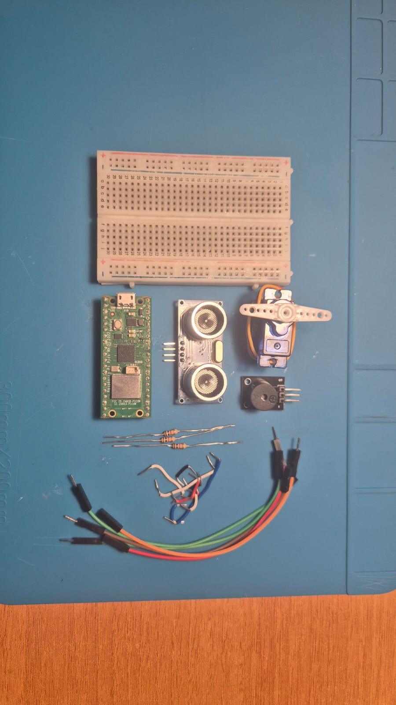

# 📡 MicroPython Ultrasonic Radar & Real-Time Visualizer

An end-to-end embedded radar detection and tracking system built with **MicroPython** and **Pygame**. 

The hardware uses a servo motor to perform a continuous 180° sweep while an ultrasonic distance sensor scans for obstacles[cite: 1]. An active buzzer provides dynamic audio alerts that beep faster as objects approach[cite: 1]. Sensor measurements are streamed live over USB Serial to a Python Pygame application on a PC, rendering a radar visual interface with color-coded threat zones and motion trails.

---

## 📸 Project Showcase & Demo

### 🎥 Live System Demo


### 🛠️ Hardware Setup & Components
| Component Layout | Assembled Radar Build |
| :---: | :---: |
|  |  |

---

## 🚀 Key Features

* **180° Radar Scanning**: Smooth forward and reverse sweep (0°–180°) powered by PWM servo control[cite: 1].
* **Real-Time Distance Sensing**: Precise proximity detection up to 50 cm using ultrasonic echo timing[cite: 1].
* **Dynamic Audio Chirp**: Non-blocking buzzer alert with variable beep intervals based on target proximity[cite: 1].
* **Interactive Desktop GUI**:
  * **Radar Sweep & Fading Overlay**: Real-time sweep needle with dynamic trail decay.
  * **Visual Proximity Zones**:
    * 🔴 **Red**: Danger Zone ($\le 15\text{ cm}$)
    * 🟡 **Yellow**: Caution Zone ($\le 35\text{ cm}$)[cite: 2]
    * 🟢 **Green**: Safe / Clear Area[cite: 2]
  * **On-Screen Heads-Up Display (HUD)**: Live target bearing angle and measured range readout[cite: 2].

---

## 🧰 Hardware & Circuit Setup

### Pinout Table

| Component | Pin / Port Connection | Notes |
| :--- | :--- | :--- |
| **Microcontroller** | Raspberry Pi Pico | Running MicroPython[cite: 2] |
| **Servo Motor (PWM)** | Pin 28 (GP28) | 50Hz PWM Signal[cite: 1] |
| **Ultrasonic Sensor (Trig)** | Pin 19 (GP19) | Output Trigger Pulse[cite: 1] |
| **Ultrasonic Sensor (Echo)** | Pin 14 (GP14) | Input Echo Signal[cite: 1] |
| **Active Buzzer Module** | Pin 18 (GP18) | Proximity Alert Output[cite: 1] |

> **Schematic Diagram**: The full circuit schematic file (`Schematic_Radar.fzz`) is included in the repository and can be opened using [Fritzing](https://fritzing.org/)[cite: 3].

---

## 📂 Repository Structure

```text
.
├── Radar.py             # MicroPython firmware running on the Pico / microcontroller
├── radar_display.py     # Desktop Pygame GUI visualizer reading serial data
├── Schematic_Radar.fzz  # Fritzing circuit schematic & layout file
└── README.md            # Project documentation
⚙️ Installation & Usage Guide1. Flash the Firmware (Microcontroller)Install MicroPython on your microcontroller (e.g., Raspberry Pi Pico)[cite: 2].Connect your hardware components according to the pinout table above.Open Radar.py in Thonny IDE and save/run it on the board.   Close Thonny or stop its execution so the COM port is released for the Pygame app[cite: 2].2. Launch the Desktop Visualizer (PC)Install the necessary Python dependencies:Bashpip install pygame pyserial
Open radar_display.py and set your device's COM port[cite: 2]:PythonPICO_PORT = 'COM4'  # Replace 'COM4' with your actual port (e.g., '/dev/ttyACM0' on Linux)
Run the visualizer application:Bashpython radar_display.py
📜 Serial Data ProtocolThe microcontroller streams angle and distance readings across USB Serial at 115200 baud in the following CSV format[cite: 1, 2]:Plaintext[Angle],[Distance_cm]
Example: 90,24.5
📄 LicenseThis project is open-source and available under the MIT License.
